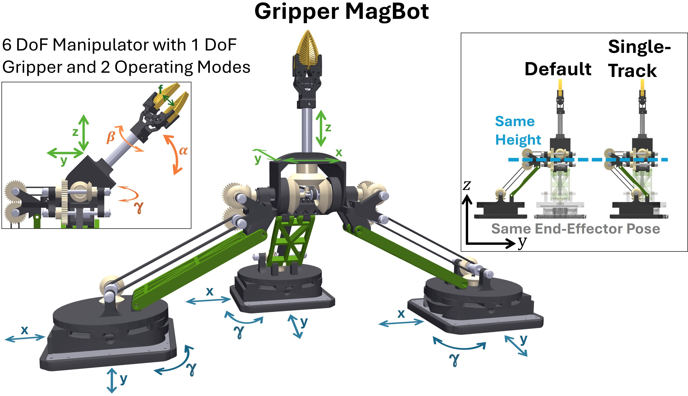

.. _gripper_magbot:

Gripper MagBot
==============

To enable grasping based solely on the MagLev system without the need for additional, expensive handling equipment, such as robot arms,
the Gripper MagBot has been developed - a low-cost parallel 6-DoF manipulator with a 1-DoF gripper that couples three MagLev movers. 
The Gripper MagBot is designed to be compatible with all industrial MagLev systems. Additionally, the MagBot can be autonomously dropped off or 
picked up by the movers using a docking station. The gripper of the MagBot is controlled by the x-, y-, and :math:`\gamma`-axes of the movers.
To enable the development of motion planning approaches for Magnetic Robotics, a MuJoCo model of the Gripper MagBot 
is integrated in the MagBotSim together with the inverse kinematics controller.

API References
--------------
The API references can be found here: :ref:`gripper_magbot_api_reference`.

.. note::
    This MagBots class assumes that the MagBot is used with a Beckhoff XPlanar system and two APM4330-0000-0000 movers, because 
    the screw holes in the mover adapters are designed for these types of movers. However, the Gripper MagBot can also be used 
    with other MagLev systems provided the movers have a similar or larger payload capacity. Only the position of the screw 
    holes in the mover adapters must be aligned with the movers' design.
